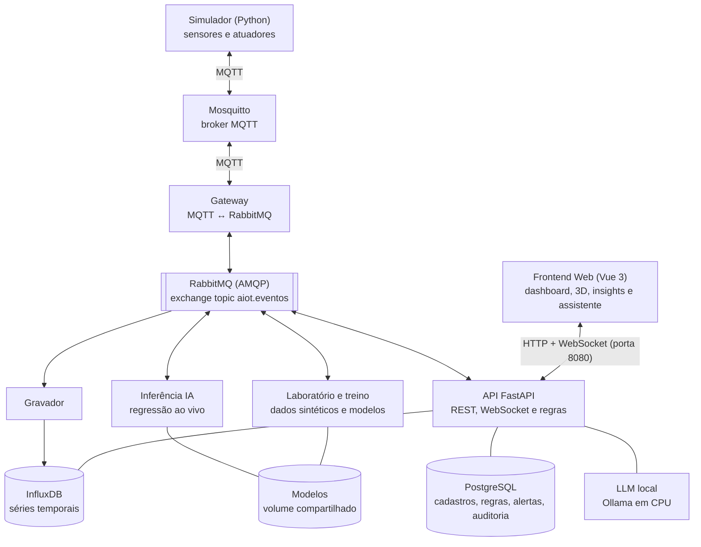

# Smart Home AIoT — Monitoramento e Manutenção Preditiva

Projeto da disciplina **Desenvolvimento de Software para Web II** (Uni-FACEF).
No 1º bimestre, o projeto monitorava a temperatura da sala com um ESP32 no Wokwi. No 2º bimestre, ele virou uma aplicação **AIoT completa (Web + IoT + Inteligência Artificial)**.

## Problema e proposta

Uma residência precisa acompanhar o ambiente e cuidar de um equipamento que se desgasta: o **compressor da geladeira**. Quando ele começa a falhar, a vibração, a corrente e a temperatura sobem aos poucos, e uma quebra inesperada estraga os alimentos.

A aplicação:

- monitora a casa em tempo real;
- liga o ventilador sozinha quando a sala esquenta;
- deixa o morador acender a lâmpada pelo navegador;
- usa **modelos de regressão** para prever a **saúde** e a **vida útil restante** do compressor, com alertas antes da falha;
- traz um **assistente com LLM local** que responde perguntas sobre os dados.

| Item | Dispositivos |
|---|---|
| Sensores (3) | `temp-sala` temperatura (°C) · `lum-sala` luminosidade (lux) · `pres-sala` presença |
| Atuadores (2) | `vent-sala` ventilador, **acionado por regra** (liga acima de 28 °C e desliga abaixo de 26 °C) · `lamp-sala` lâmpada, **comandada pela Web** |
| Equipamento monitorado | `comp-geladeira` compressor: **vibração** (mm/s), **corrente** (A) e **temperatura** (°C) |

## Arquitetura

Todo dado passa pelo RabbitMQ. A IA fica entre a telemetria e a interface, e cada banco tem um papel diferente.



**Três fluxos:**

1. **IoT → Web:** simulador → MQTT → gateway → RabbitMQ → gravador (InfluxDB) e API → WebSocket → dashboard e cena 3D.
2. **Web → IoT:** botão no dashboard → API → RabbitMQ (`comando.<id>`) → gateway → MQTT → simulador. O atuador muda de estado e isso aparece nas leituras seguintes (com a lâmpada ligada, a luminosidade sobe cerca de 350 lux).
3. **IA:** o laboratório gera os dados sintéticos, o treino cria os modelos, a inferência aplica os modelos à telemetria ao vivo e devolve previsões e alertas pelo RabbitMQ até a interface.

**Papel de cada banco:**

- **InfluxDB:** leituras e telemetria (bucket `iot`), previsões da IA e a amostra dos dados sintéticos (bucket `lab`, separado dos dados ao vivo).
- **PostgreSQL:** usuários, dispositivos, regras, configurações, alertas, jobs, versões dos modelos e auditoria.

### RabbitMQ

- **Exchange** `aiot.eventos` (tipo *topic*). Routing keys: `telemetria.<zona>.<tipo>.<id>`, `comando.<id>`, `previsao.<id>`, `alerta.<id>`, `job.lab`, `job.treino`, `progresso.<job>` e `modelo.atualizado`.
- **Filas e consumidores:** `q.gravador` (InfluxDB), `q.inferencia` (IA), `q.websocket` (entrega ao navegador), `q.comandos` (de volta ao dispositivo), `q.regras` (regras e persistência) e `q.jobs.lab`/`q.jobs.treino` (jobs demorados, para a API não travar).
- **DLQ:** o exchange `aiot.dlx` leva à fila `aiot.dlq`. Toda mensagem que falha é rejeitada e vai para lá, preservada.
- **Formato único** em JSON: `{id, instante, tipo, dispositivo, conteudo}`.
- **Um usuário por serviço**, só com as permissões necessárias (`gateway`, `gravador`, `inferencia`, `lab`, `api`). O usuário `guest` não existe.

### IA

- **Dados sintéticos:** simulam a vida inteira de dezenas de compressores, com degradação **progressiva**, ciclo diário, ruído, leituras faltantes, valores absurdos e defeitos de sensor (deriva e travamento). O padrão gera **3,1 milhões de leituras** com numpy em blocos, com teto de 20 milhões. Os rótulos (saúde e vida útil) existem só nos dados de treino e **nunca** vão na telemetria ao vivo.
- **Dois modelos de regressão** (scikit-learn, `HistGradientBoostingRegressor`):
  - **vida útil restante** (horas, até 240);
  - **índice de saúde** (0–100).
- **Treino sem vazamento:** as features vêm de um **único código** (`services/common/aiot_common/features.py`), usado no treino e na inferência. As janelas olham só para o passado. A divisão em treino, validação e teste é **por equipamento**. Cada modelo é comparado com a base que prevê sempre a média, e só entra em uso se vencê-la.
- **Troca sem reinício:** o modelo novo entra em uso sem reiniciar a inferência. A versão em uso aparece na tela.
- **Alertas com histerese:** 3 previsões seguidas ruins para abrir e 10 boas para fechar.

> O simulador é acelerado: cada leitura (a cada 2 s) representa 5 minutos de operação, então 1 dia simulado dura cerca de 10 minutos. As horas de vida útil são horas simuladas.

## Tecnologias

| Camada | Tecnologia |
|---|---|
| Frontend | Vue 3 + TypeScript + Vite |
| Visualização 2D / 3D | Chart.js / Three.js |
| Backend | Python + FastAPI (REST + WebSocket) |
| IoT | MQTT + Mosquitto (sem acesso anônimo, ACL por tópico) |
| Dispositivo | Simulador em Python (substitui o ESP32/Wokwi do 1º bimestre) |
| Mensageria | RabbitMQ |
| IA | Python + scikit-learn |
| LLM local | Ollama com `llama3.2:3b`, em CPU |
| Bancos | PostgreSQL e InfluxDB |
| Infraestrutura | Docker + Docker Compose |
| Versionamento | Git + GitHub |

## Como subir

Pré-requisitos: **Docker Desktop** (ou Docker Engine com Compose) com pelo menos **6 GB de memória** em *Settings → Resources*. Não é preciso instalar Python, Node, bancos nem brokers na máquina.

```bash
# 1. Só na primeira vez: gera o .env com senhas e chaves aleatórias (ignorado pelo Git)
./scripts/gerar-segredos.sh

# 2. Sobe a solução inteira
docker compose up -d
```

Abra **http://localhost:8080**.

A **primeira** subida demora alguns minutos, porque baixa as imagens, compila o frontend e baixa o modelo de LLM (~2 GB). Nas próximas, leva menos de um minuto. Para acompanhar: `docker compose ps` (todos devem ficar `healthy`) e `docker compose logs -f`.

Para desligar e liberar a memória:

```bash
docker compose down        # mantém os dados (volumes)
docker compose down -v     # apaga também os dados, modelos e o LLM baixado
```

### Usuários de demonstração

As senhas são geradas pelo script e ficam só no `.env`. Elas aparecem no terminal quando o script roda.

| Usuário | Papel | Pode |
|---|---|---|
| `visualizador` | visualizador | só ver |
| `operador` | operador | também comandar atuadores e injetar falhas no simulador |
| `administrador` | administrador | também gerar dados, treinar modelos, cadastrar dispositivos, alterar regras e ver a auditoria |

### Interfaces de estudo (somente em `127.0.0.1`)

Os links também aparecem na página **Administração**.

| Interface | Endereço | Acesso |
|---|---|---|
| RabbitMQ | http://127.0.0.1:15672 | `admin` / `RABBITMQ_SENHA_ADMIN` |
| InfluxDB | http://127.0.0.1:8086 | `admin` / `INFLUX_SENHA` |
| pgAdmin | http://127.0.0.1:5050 | abre direto; servidor "AIoT" com a senha `POSTGRES_SENHA` |
| Swagger da API | http://localhost:8080/api/docs | documentação da API REST |

## Segurança

- Login com **JWT** e três papéis. Senhas com **bcrypt**. Bloqueio de 5 minutos após 5 senhas erradas, mais um limite por IP.
- **Nenhum segredo no Git:** tudo vem do `.env`, gerado por `scripts/gerar-segredos.sh`. Não existe usuário padrão como `admin/admin`.
- **Mosquitto** sem acesso anônimo: cada cliente tem usuário e permissões por tópico (`mosquitto/acl`). **RabbitMQ** com um usuário por serviço.
- O WebSocket **não recebe o JWT na URL**: o navegador pede um ticket curto, de uso único (`POST /api/ws/ticket`).
- Os containers da aplicação **não rodam como root**, e só a porta do frontend (8080) fica publicada.
- Tabela de **auditoria** no PostgreSQL: logins, comandos (do usuário e da regra), jobs e perguntas ao assistente.
- O LLM é **local** (Ollama no Compose), sem chave de API e sem enviar dados para a nuvem. A resposta é tratada como texto não confiável: HTML escapado, sem imagens nem links. Há limite de perguntas por minuto.

## Roteiro da demonstração (16/11)

> **Antes da apresentação**, deixe tudo rodando por alguns minutos e já faça uma geração e um treino. Assim o modelo fica pronto e o LLM fica carregado na memória.

1. **Containers saudáveis:** `docker compose up -d` e depois `docker compose ps`.
2. **Login e papéis:** entre como `visualizador` (os botões de comando ficam desabilitados), depois como `operador` e `administrador` (o menu **Administração** aparece só para ele).
3. **Simulador e Mosquitto:** mostre as mensagens MQTT passando:
   ```bash
   docker compose exec mosquitto sh -c 'mosquitto_sub -u monitor -P "$MQTT_SENHA_MONITOR" -t "aiot/#" -v'
   ```
4. **API REST:** abra http://localhost:8080/api/docs.
5. **Mensageria:** mostre filas, taxas, consumidores e DLQ. Para o **consumidor parado**, rode `docker compose stop gravador` (a fila `q.gravador` cresce) e depois `docker compose start gravador` (ela esvazia). O botão **Publicar mensagem inválida** manda uma mensagem para a DLQ.
6. **Bancos:** leituras no InfluxDB (Data Explorer → bucket `iot` → measurement `telemetria`). Dispositivos, regras e auditoria no pgAdmin ou nas páginas **Dispositivos** e **Administração**. O histórico aparece no gráfico do Dashboard.
7. **Dashboard ao vivo:** valores, indicadores, histórico e eventos chegando pelo WebSocket.
8. **Atuadores:**
   - a **lâmpada** é comandada pelo botão (a luminosidade sobe nas leituras seguintes);
   - o **ventilador** é ligado pela regra. Em **Dispositivos**, baixe o limite da regra abaixo da temperatura atual para ele ligar na hora, e depois volte para 28/26.
9. **Laboratório de Dados:** gere os dados sintéticos (o padrão gera 3,1 milhões de leituras) e mostre o progresso e a amostra no bucket `lab`.
10. **Treinamento:** treine e mostre MAE, RMSE, R², previsto contra real, importância dos atributos, comparação com a base e a versão em uso.
11. **Falha injetada:** em **Insights**, escolha um modo de falha e clique em **Injetar falha**. Em 2 a 4 minutos, a saúde e a vida útil caem e o alerta passa de "atenção" para "crítico", em **Insights** e na cena **Gêmeo 3D** (o compressor fica vermelho e treme mais). **Reparar compressor** volta ao normal.
12. **Assistente:** pergunte, por exemplo, "Por que o compressor está com alerta e o que devo fazer?". A resposta chega em streaming.

## Estrutura do repositório

```
├── docker-compose.yml        # a solução inteira (um comando)
├── scripts/gerar-segredos.sh # cria o .env com as senhas
├── mosquitto/                # configuração, ACL e criação dos usuários do broker
├── pgadmin/servers.json      # servidor PostgreSQL pré-cadastrado no pgAdmin
├── services/                 # backend em Python (um container por serviço)
│   ├── common/aiot_common/   # código compartilhado: modelo do equipamento, features, mensagens
│   ├── simulador/            # dispositivo IoT simulado (MQTT)
│   ├── gateway/              # MQTT ↔ RabbitMQ
│   ├── gravador/             # RabbitMQ → InfluxDB
│   ├── inferencia/           # modelos aplicados à telemetria ao vivo
│   ├── lab/                  # geração de dados sintéticos e treino
│   ├── api/                  # FastAPI: REST, WebSocket, regras, assistente
│   └── rabbit-init/          # cria vhost, usuários, exchanges, filas e bindings
└── frontend/                 # Vue 3 + TypeScript + Vite (servido por nginx sem root)
```

## Problemas comuns

- **Porta 8080 em uso:** feche o outro programa ou troque `"8080:8080"` por `"8081:8080"` no `docker-compose.yml`.
- **A página Assistente mostra "Baixando o modelo":** o `ollama-init` ainda está baixando o `llama3.2:3b`. Acompanhe com `docker compose logs -f ollama-init`.
- **A primeira resposta do assistente demora:** em CPU, o modelo leva alguns segundos para processar a pergunta. As respostas seguintes são mais rápidas.
- **Insights sem previsões:** é preciso gerar os dados e treinar pelo menos uma vez (passos 9 e 10).
- **Serviços sem conectar depois de rodar o script com `--forcar`:** os bancos e o RabbitMQ guardam nos volumes as senhas antigas. Rode `docker compose down -v` e suba de novo.
